# Bluff Table

**술집 테이블의 네 사람이 카드로 블러핑하고, 거짓말이 들키면 러시안 룰렛을 돌리는 Unity 3D 온라인 멀티플레이 카드 게임 <br/>
원작 : Liar's Bar(Steam)**

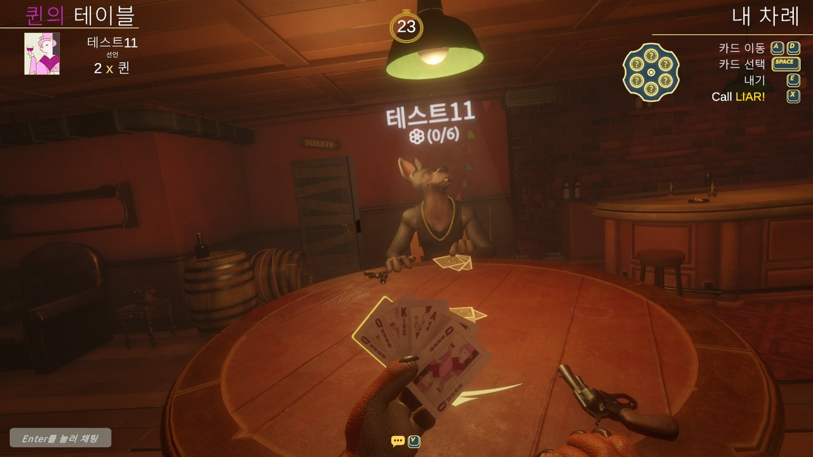

      

## 📌 프로젝트 개요 (Project Overview)

| 항목 | 내용 |
|---|---|
| **장르** | 1인칭 블러핑 카드 게임 (4인 온라인 멀티플레이) |
| **엔진** | Unity 6000.2.8f1 (C#, URP) |
| **개발 기간** | 2026.10.12 ~ 2026.10.26 (2주) |
| **개발 인원** | 3인 팀 프로젝트 |
| **담당 파트** | UI 전반 · 인게임 연출 (HUD, 판정 · 승리 · 장전 연출, 전적 UI, 퀵챗, 설정 · 현지화) |
| **기술 스택** | Mirror (네트워크) · MariaDB (계정 · 전적) · AWS (데디케이티드 서버) |
| **플랫폼** | PC (Windows) |
| **기술개발서** | 슬라이드 기반 UI · 연출 기술개발서 별도 제작 |

## 👥 팀 구성 (Team)

| 이름 | 담당 |
|---|---|
| **김종찬** | UI 전반, 인게임 연출, 전적 UI · 퀵챗, 원작 에셋 이식 · 에디터 도구 |
| **박지은** | 플레이어 및 게임전반 로직,라이팅,볼륨 작업 |
| **박진호** | 서버 전반 로직,레벨 디자인,원작 에셋 이식,에디터 도구 |

## 🎮 조작법 (Controls)

| 입력 | 동작 |
|---|---|
| `마우스` | 고개 돌리기 (옵션에서 감도 조절) |
| `A` `D` | 손패에서 카드 이동 |
| `W` / `S` | 카드 고르기 / 해제 |
| `Space` | 내 차례: 카드 고르기 · 그 외: 패 펼치기 / 덮기 |
| `E` | 고른 카드 내기 (최대 3장) |
| `X` | LIAR! (앞사람 카드 지목) |
| `1` ~ `5` | 감정 표현 |
| `V` → `1` ~ `5` | 퀵챗 (정해진 대사 말풍선) |
| `Enter` | 텍스트 채팅 |
| `A` `D` (사망 후) | 관전 대상 바꾸기 |
| `ESC` | 메뉴 (계속 · 설정 · 나가기, 조작법 안내) |

## 🔄 게임 흐름 (Game Flow)

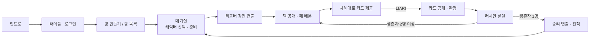

## ⚙️ 핵심 시스템 (담당 파트 : UI · 연출)

### 01. 이벤트 기반 UI 구조 · `InGameEvent`

서버가 결과와 타이밍을 정하고, UI와 연출은 `InGameEvent`의 정적 이벤트를 구독해서 보여 주기만 합니다. 네 플레이어가 같은 장면을 같은 순서로 보고, UI를 고쳐도 팀원의 게임 로직은 건드리지 않습니다. 연출 컴포넌트는 `RuntimeInitializeOnLoadMethod`로 스스로 생성되어 같은 씬을 여러 명이 고쳐도 충돌이 나지 않습니다.

### 02. 타이틀 · 대기실 UI · `RoomLobbyUI` / `LobbyCharacterView` / `LobbyTutorialUI`

<p align="center">
  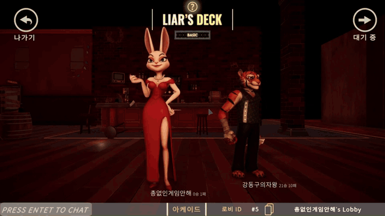
  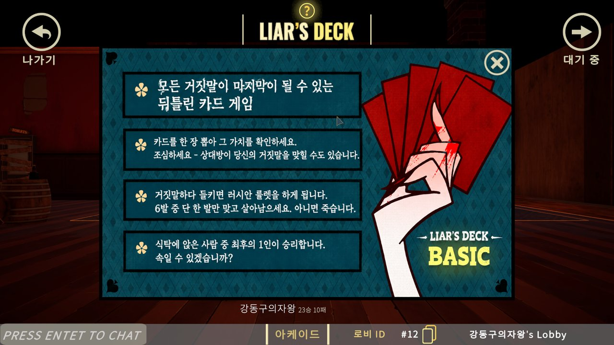
</p>

대기실에서 캐릭터에 마우스를 올리면 아웃라인과 "캐릭터 변경" 라벨이 뜨고, 클릭할 때마다 다음 캐릭터로 바뀌어 다른 플레이어에게도 동기화됩니다. `?` 버튼의 룰 안내는 DOTween으로 위에서 떨어지며 등장하고, 하단 바에는 채팅 · 모드 · 로비 ID(복사) · 방 이름이 있습니다.

### 03. 인게임 HUD · `InGameHUD`

<p align="center">
  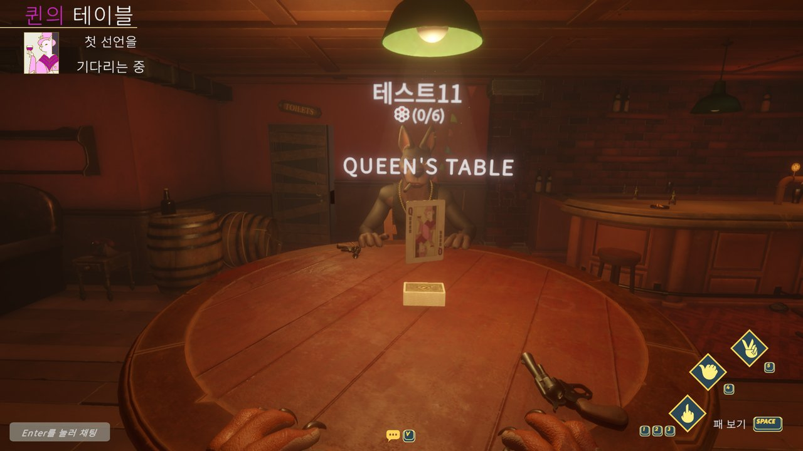
  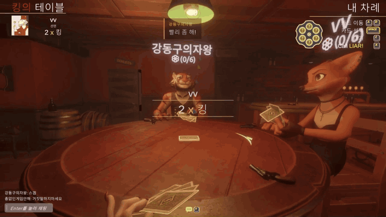
</p>

원작 배치를 따른 HUD입니다. 라운드 시작에 테이블 카드("QUEEN'S TABLE")를 공지하고, 좌측 상단에 앞사람의 선언("2 x 퀸"), 내 차례에는 우측 상단에 조작 안내 · 리볼버 잔탄 · 턴 타이머를 표시합니다. 내 차례가 아닐 때는 우측 하단에 감정 표현과 "패 보기" 안내가 나옵니다.

### 04. 머리 위 이름판 · `NamePlateSync` / `NamePlateBoard`

<p align="center">
  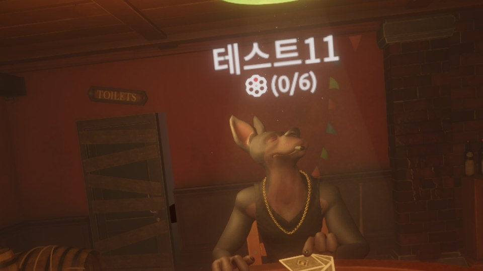
</p>

이름과 당긴 횟수(n/6)를 머리 위에 띄우고, 애니메이션 뒤 `LateUpdate`에서 머리를 부드럽게 따라갑니다. 높이는 테이블 크기에 비례하고, 내 이름판과 결과 화면에서는 숨깁니다.

### 05. 게임 시작 장전 연출 · `GunReloadPresenter`

<p align="center">
  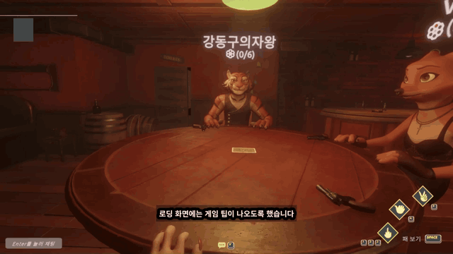
</p>

로딩 직후 모든 캐릭터가 리볼버에 탄을 넣고 테이블에 내려놓은 뒤 덱 공개로 넘어갑니다. 서버가 `RpcGunReload`를 보내고 연출 시간(`GameFlowTiming.GunReload`)만큼 기다립니다.

### 06. LIAR 판정 연출 · `OnLiarCardsRevealed`

<p align="center">
  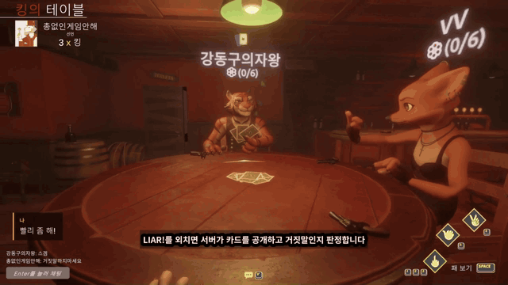
</p>

LIAR가 외쳐지면 좌측 상단에 "거짓말!"을 띄우고, 지목된 카드를 펼쳐 카드마다 맞음(초록) / 틀림(빨강)을 표시한 뒤 룰렛으로 넘어갑니다. 카드를 펼치는 기준을 카메라가 아닌 "의자 → 테이블 중앙" 방향으로 잡아, 네 플레이어 모두 같은 모양을 봅니다.

### 07. 승리 연출 · `WinnerPresenter`

<p align="center">
  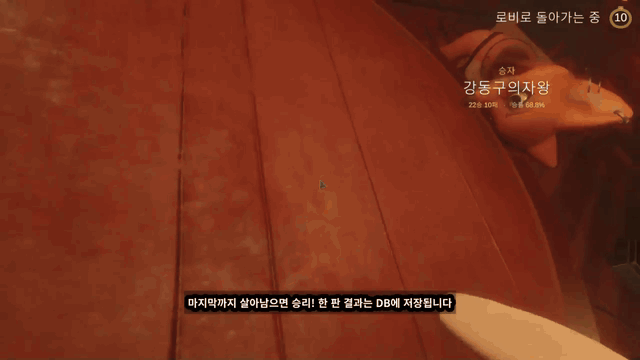
</p>

승자의 고개가 마우스 커서를 따라 움직입니다(원작의 재미 요소). 각도는 0.1초 간격으로 서버에 동기화되어 다른 플레이어에게도 보입니다. 승자 이름 아래에는 이번 승리를 반영한 전적과 승률을, 우측 상단에는 로비 복귀 카운트다운을 표시합니다.

### 08. 전적 UI (MariaDB 연동) · `TitleStatsUI` / `RecordFormat`

<p align="center">
  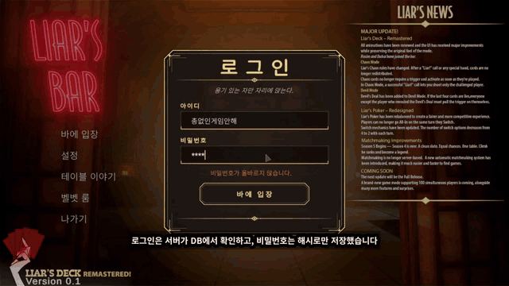
  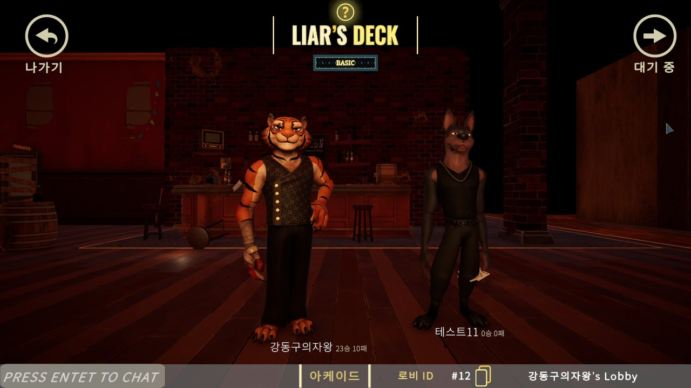
</p>

타이틀 우측 하단 패널에 승 · 패 · 판 수 · 승률 막대와 칭호(새내기 → 바의 전설, 5단계)를 카운트업 연출로 보여 주고, 대기실 이름표와 승리 화면에도 표시합니다. DB 저장 · 재조회가 승리 화면보다 늦게 오므로, 게임 시작 때 찍어 둔 전적에 이번 승리를 더해 바로 계산합니다.

### 09. 퀵챗 · `QuickChatUI`

<p align="center">
  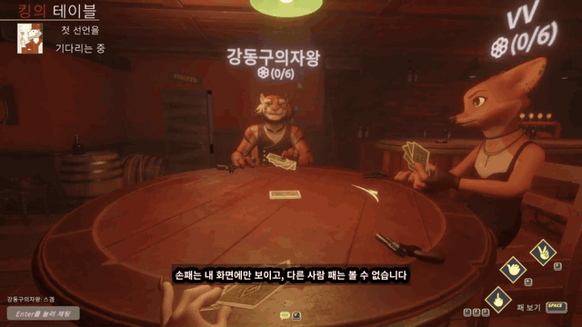
  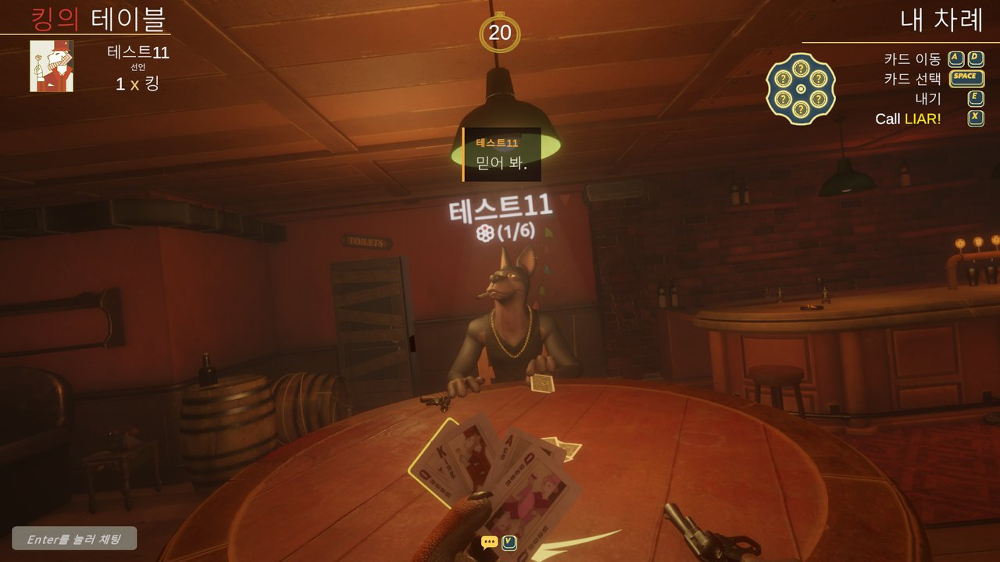
</p>

음성 채팅 대신 넣은 기능입니다. `V`로 목록을 열고 `1` ~ `5`로 대사를 고르면 말한 사람의 이름판 위에 말풍선이 뜹니다. 네트워크로는 대사 번호만 보내 받는 사람의 언어로 표시되고, 서버가 범위와 2초 쿨다운을 검사해 임의 문장은 보낼 수 없습니다.

### 10. 사망 화면 · 관전 · `DeathScreenUI` / `PlayerSpectator`

<p align="center">
  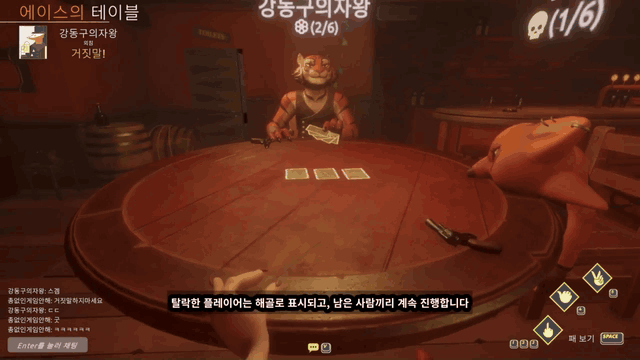
</p>

LIAR 판정에서 지면 리볼버를 머리에 대고 방아쇠를 당기고, 실탄이면 사망 연출 후 관전 모드로 바뀌어 `A` `D`로 남은 플레이어를 돌아가며 봅니다.

### 11. 설정 · 현지화 · 해상도 · 커서

<p align="center">
  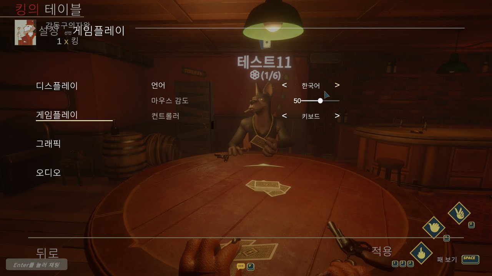
  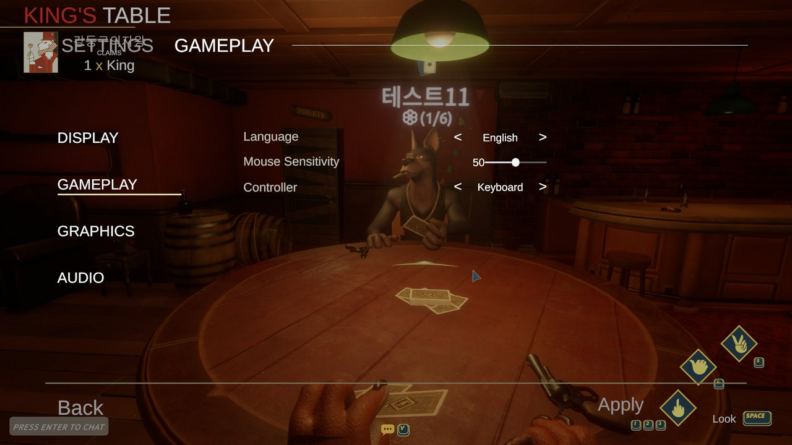
</p>

- `SettingsMenuUI`: 디스플레이 · 게임플레이 · 그래픽 · 오디오 탭, 인게임 ESC 메뉴에서도 같은 패널 사용
- `Localization`: `Strings.csv`(en, ko) 한 파일로 한국어 / 영어 전환 (위: 같은 화면의 한국어 · 영어)
- `ResolutionAdapter`: CanvasScaler 방식을 실행 중 하나로 통일하고, 1920x1080 고정 배경 26개를 화면을 덮도록 키움
- `CustomCursor`: 원작 커서 적용, 게임 중에는 잠금 · ESC 메뉴에서만 창 밖으로 이동 가능 (듀얼 모니터 대응)

<details>
<summary>설정 화면 더 보기 (디스플레이 · 그래픽)</summary>

<p align="center">
  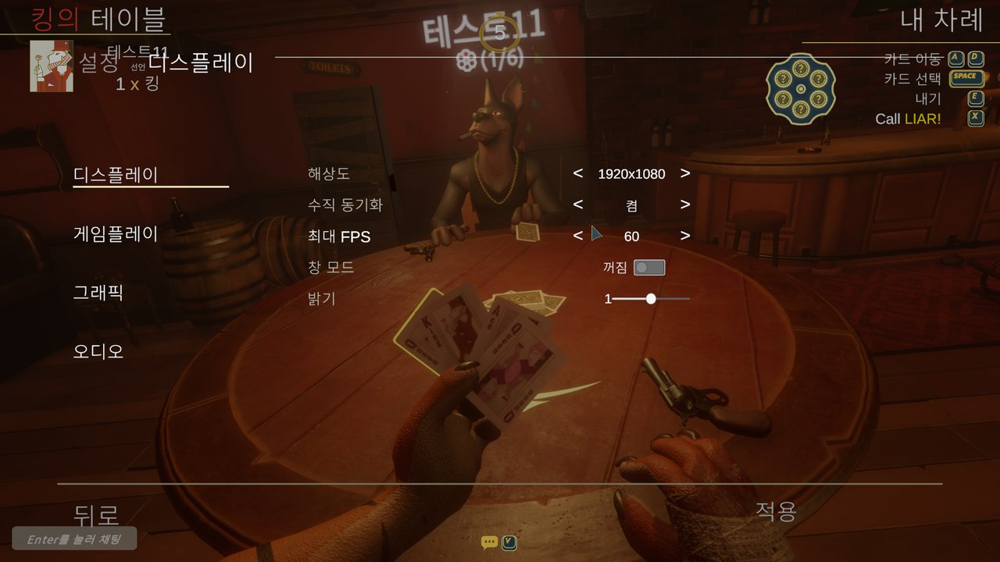
  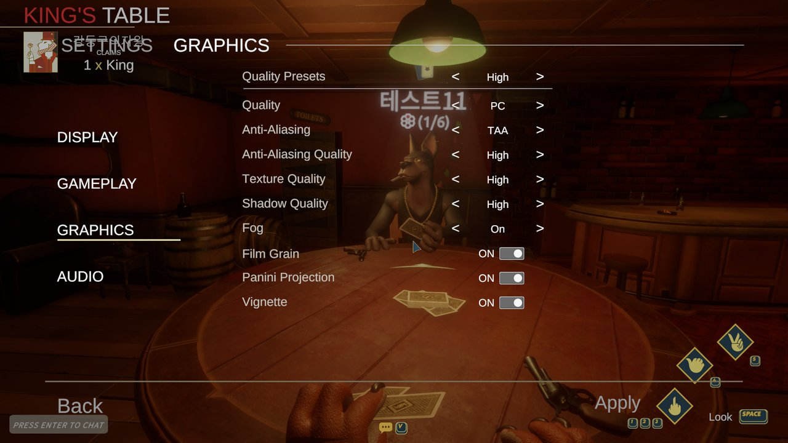
</p>

</details>

## 🏗️ 설계 포인트 : "UI는 판단하지 않는다"

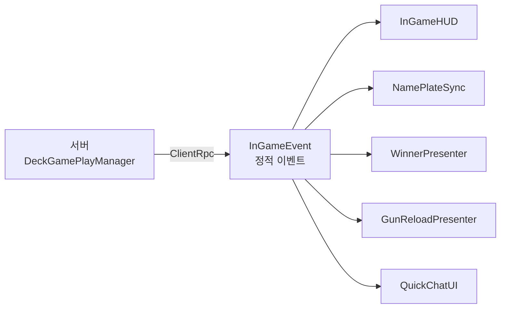

누구 차례인지, 누가 거짓말했는지, 누가 죽었는지는 전부 서버가 정합니다. UI는 이벤트를 받는 순간 연출을 시작할 뿐이라, 클라이언트마다 판단이 엇갈리지 않습니다. 새 연출은 이벤트 하나를 구독하는 컴포넌트를 추가하는 것으로 끝납니다.

## 🛠️ 트러블슈팅 (Troubleshooting)

| 문제 | 원인 | 해결 |
|---|---|---|
| 내 차례에 패가 덮인 채 잠김 | 차례 직전에 누른 "덮기" 요청이 서버를 거쳐 늦게 도착 | "차례 시작에 한 번 펼침"을 "내 차례 동안 항상 펼쳐짐" 상태로 바꾸고 0.5초 간격으로 재요청 |
| 특정 캐릭터만 카드 색이 다름 | 원작 모델마다 손패 머티리얼 · 렌더링 레이어가 다름 | 손패 생성 시 머티리얼을 통일하고 렌더링 레이어에 Default를 더함 |
| 총 발사 이펙트가 흰 사각형으로 보임 | HDRP 머티리얼 + 원작의 채널 패킹 텍스처(G 채널만 사용) | URP 파티클 셰이더로 변환하고 원작 채널만 뽑은 마스크 텍스처 생성 |
| 원작 애니메이션 클립이 움직이지 않음 | 리핑된 클립의 본 경로가 해시값(CRC32)으로 저장됨 | 실제 계층 경로로 복구하는 에디터 도구 제작 |
| 승리 화면 전적이 늦게 바뀜 | DB 저장 후 재조회가 결과 화면보다 늦게 도착 | 게임 시작 때 전적을 찍어 두고 이번 승리를 더해 즉시 표시 |
| 해상도에 따라 UI · 배경이 틀어짐 | 씬마다 CanvasScaler 방식이 섞여 있고 배경이 1920x1080 고정 | 실행 중 Expand로 통일 + 고정 배경을 화면을 덮도록 확대 |
| 인트로에서 가끔 무한 로딩 | 에디터 Game 뷰가 다시 그려지지 않으면 `WaitForEndOfFrame`이 끝나지 않음 | `yield return null`로 교체, 영상 정지 감지 · 씬 미리 읽기에 시간 제한 |
| 클론 에디터와 동시 테스트 시 로딩이 멈춤 | 포커스 없는 창의 실행이 멈춤 (`runInBackground`가 타이틀부터 켜짐) | 첫 씬 로드 전에 켜는 부트스트랩 추가 |
| 한국어에서 ESC 조작법 글자가 사라짐 | TMP Ellipsis 모드 + 한글 대체 폰트의 줄 높이가 칸보다 큼 | 줄넘침을 Overflow로, 칸 높이를 늘림 |
| 마우스 감도 슬라이더가 동작하지 않음 | 저장된 감도 값을 시선 코드가 읽지 않음 | `HeadController`에서 옵션 배율을 곱함 |
| 듀얼 모니터 풀스크린에서 마우스가 밖으로 나감 | 커서 잠금 설정이 없음 | 게임 중 Locked, ESC 메뉴 None, 그 외 Confined |
| 미사용 리소스 리포트가 너무 적게 잡힘 | 에디터 도구 안의 경로 문자열까지 "사용 중"으로 셈 | `/Editor/` 스크립트를 판정 기준에서 제외 (359개 → 858개) |

## 🧭 설계 원칙 (Design Principles)

| 원칙 | 내용 |
|---|---|
| **UI는 판단하지 않는다** | 결과 · 타이밍은 서버, UI는 이벤트 구독과 표시만 |
| **씬에 놓지 않는다** | 연출 · UI 매니저는 실행 시 스스로 생성 → 팀원과 씬 충돌 없음 |
| **반복은 에디터 메뉴로** | 원작 에셋 이식 · UI 생성을 메뉴 한 번으로, 여러 번 실행해도 같은 결과 (`[Gen]` 오브젝트만 다시 만듦) |
| **원작부터 확인** | 버그는 증상보다 원작이 하던 일과 판정 기준부터 확인 |

## 📁 폴더 구조 (Folder Structure)

```
Assets/
├─ 1.Scene/              # 인트로 · 타이틀 · 로비 · 인게임
├─ 2.Model/Prefabs/      # 플레이어 · UI · 테이블 프리팹
├─ 3.Script/
│  ├─ AudioManager/      # BGM · SFX · 캐릭터 보이스
│  ├─ Cards/             # 카드 배치 · 테이블 카드 공지
│  ├─ Char/              # 손패 · 이름판 · 착석 · 장전 연출
│  ├─ ETC/               # 설정 · 현지화 · 씬 전환 · 해상도
│  ├─ InGamePlay/        # InGameEvent · 게임 진행 · 플레이어 상태
│  ├─ Input/             # Input System 액션
│  ├─ Server/            # Mirror 네트워크 · 로비 · DB
│  ├─ Title/             # 인트로 · 커서
│  └─ UI/                # HUD · 메뉴 · 전적 · 퀵챗 · 승리 · 사망 화면
├─ Editor/               # 원작 에셋 이식 · UI 생성 · 리소스 정리 도구
└─ Resources/Localization/Strings.csv
```

## 🗺️ 향후 계획 (Roadmap)

- [ ] Quick Join · ID로 방 입장
- [ ] 원작의 다른 모드 (Dice 등)
- [ ] 음성 채팅 (Vivox 위치 기반 채널)

## 📦 사용 기술 · 에셋 (Assets Used)

- [Mirror](https://mirror-networking.com/): 네트워크 (Command · ClientRpc · SyncVar)
- [DOTween](http://dotween.demigiant.com/): UI · 연출 트윈
- Cinemachine 3 · Input System · TextMesh Pro (Noto Sans KR)
- [ParrelSync](https://github.com/VeriorPies/ParrelSync): 에디터 멀티 클라이언트 테스트

---

<div align="center">
본 프로젝트는 학습 및 팀 포트폴리오 목적의 비상업적 모작입니다.<br/>
*Liar's Bar(라이어스 바)*의 모든 권리는  Curve Animation(커브 애니메이션)에 있습니다.
</div>

**김종찬** · [GitHub](https://github.com/Chan1605)
